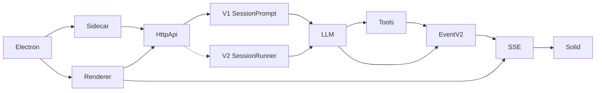
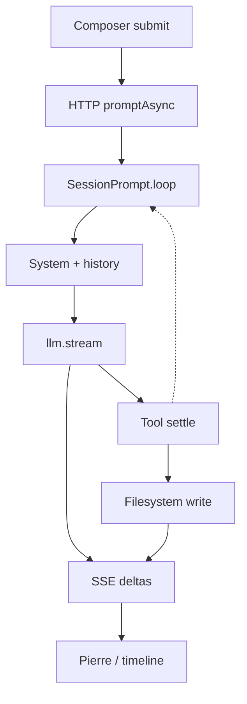

# OpenCode architecture vs Cursor

Deep-dive of this fork: process map, SSE latency, missing retrieval index, agent loop, and a file-specific plan to close the gap with Cursor.

Findings are from source, not runtime traces. Timings below are code constants (16 ms coalesce, 2000-line reads, etc.), not measured TTFB.

**Date:** 2026-09-06

---

## Summary

OpenCode is a **sidecar coding agent with a chat-and-diff UI**, not an editor-native agent. The biggest gaps versus Cursor are not the SSE frame timer. They are:

1. The Desktop GUI still runs the **legacy V1 prompt loop**.
2. There is **no local retrieval index** (no embeddings, BM25 corpus, or AST index).
3. File changes are **rendered after the fact** in Pierre cards instead of streamed into a live editor buffer.

The V2 algebra (admit vs execute, Context Epoch, one `llm.stream` per turn, `FileMutation` mutex) is already closer to a serious agent runtime than V1’s `while (true)`. The product still boots into V1, searches with grep, and paints Pierre.

---

## 1. Architectural blueprint and process mapping

### 1.1 Process map

```
Electron main (packages/desktop)
  ├─ utilityProcess sidecar → Effect HttpApi on 127.0.0.1
  └─ BrowserWindow + preload (window.api = OS chrome only)

Renderer (packages/desktop/src/renderer → @opencode-ai/app)
  ├─ HTTP CRUD + prompt
  ├─ fetch SSE  GET /global/event  or  GET /api/event
  └─ WebSocket  /api/pty/:id/connect   (terminals only)

Sidecar (packages/opencode/src/server/server.ts)
  ├─ InstanceHttpApi     POST /session/:id/message     ← GUI still lands here
  ├─ @opencode-ai/server POST /api/session/:id/prompt  ← V2, mounted, not default GUI
  ├─ EventApi            SSE
  └─ PtyConnectApi       WebSocket
```



Dashed V2 edge: mounted on the same listener, not the Desktop product path.

### 1.2 Package ownership

| Surface | Package | Owns |
|---|---|---|
| Desktop shell | `packages/desktop` | Electron main, preload, sidecar spawn, native IPC |
| Product UI | `packages/app` | SolidJS routes, SDK, SSE coalesce, prompt submit, file tabs |
| Timeline / diffs | `packages/session-ui` | Pierre file/diff viewers, apply_patch cards, markdown |
| Design system | `packages/ui` | Theming, `FileComponentProvider` |
| Sidecar HTTP | `packages/opencode/src/server` | Effect `HttpApi` + Node `http.createServer` — **not Hono**, not `Bun.serve` in production |
| V1 agent | `packages/opencode/src/session` | `SessionPrompt.loop`, processor, V1 tools, LSP |
| V2 agent | `packages/core/src/session` | Durable inbox, `SessionRunner`, System Context, `FileMutation` |
| V2 HTTP | `packages/server` | `POST /api/session/:id/prompt` handlers |
| Contracts | `packages/schema`, `packages/protocol` | Events, session IDs, HttpApi groups |
| LLM runtime | `packages/llm` | Native route/stream; AI SDK remains the session default |

`packages/sdk-next` is an in-process Effect client. It is not the Desktop renderer path.

Hono appears only in unrelated packages (`packages/function`, `packages/enterprise`). Production listen uses Node `http.createServer` via `@effect/platform-node` `NodeHttpServer` in `packages/opencode/src/server/server.ts`.

### 1.3 Desktop vs web

Same UI (`AppInterface` in `packages/app`). Different entry + `Platform`:

- **Desktop:** `packages/desktop/src/renderer/index.tsx` — `platform: "desktop"`, talks to `window.api` (preload).
- **Web:** `packages/app/src/entry.tsx` — `platform: "web"`.

Desktop sets `OPENCODE_DISABLE_EMBEDDED_WEB_UI = "true"` so the sidecar does not serve the web UI (`packages/desktop/src/main/index.ts`). Sidecar spawn: `packages/desktop/src/main/server.ts` → `utilityProcess.fork(sidecar.js)` → `packages/desktop/src/main/sidecar.ts` imports `virtual:opencode-server` and `Server.listen(...)`.

IPC (`packages/desktop/src/main/ipc.ts`) is **OS/window/native only**: dialogs, updater, drafts, menus, WSL. Session events do **not** go through IPC. The renderer `fetch`es `http://127.0.0.1:<port>` directly.

### 1.4 Critical finding: the GUI still prefers V1

Protocol detection probes `/global/health` first and returns `"v1"` if that endpoint is healthy:

```ts
// packages/app/src/utils/server-protocol.ts
export async function detectServerProtocol(...): Promise<ServerProtocol> {
  const legacy = await probe(server, fetch, "/global/health").catch(() => undefined)
  if (legacy && "healthy" in legacy && legacy.healthy === true) return "v1"
  // ...
}
```

The sidecar still serves that health route, so `createCompatibleApi` binds the V1 adapter. Prompts then call `legacy().session.promptAsync(...)` — fire-and-forget 204 — not `SessionV2.prompt`.

```ts
// packages/app/src/utils/server-compat.ts
async prompt(value: SessionPromptInput & LegacyPrompt) {
  await legacy().session.promptAsync({
    sessionID: value.sessionID,
    messageID: value.id ?? undefined,
    // ...
  })
}
```

Composer submit: `packages/app/src/components/prompt-input/submit.ts` → `input.api.prompt({ legacyParts, text, files, agents })`.

V2 is real code (`packages/core/src/session.ts` `V2Session.prompt` → `SessionInput.admit` → `SessionExecution.wake`). It is not what Desktop users run today. Dual-stack is the first architectural tax.

### 1.5 State synchronization

| Channel | Mechanism | Used for |
|---|---|---|
| HTTP JSON | `@opencode-ai/client` `OpenCode.make` | CRUD, prompt, `file.read`, `vcs.diff` |
| **SSE** | fetch body reader, **not** `EventSource` | Session deltas, permissions, watcher |
| WebSocket | Ghostty PTY | Terminal I/O only |
| Electron IPC | `packages/desktop/src/main/ipc.ts` | Dialogs, updater, drafts, menus — **not** session state |
| Query refetch | TanStack Query | Bootstrap, health, review diffs |

There is **no** `new EventSource(...)` in `packages/app` or `packages/desktop`. TUI has its own SSE wrapper in `packages/tui/src/context/sdk.tsx`.

Live path:

```
EventV2.publish
  → EventV2Bridge + GlobalBus
  → GET /global/event  (V1 GUI)  or  GET /api/event
  → server-sdk.tsx queue (16ms coalesce, 8ms yield)
  → server-sync applyV2/apply
  → Solid stores → session-ui
```

**Client**

- Start: `packages/app/src/context/server-sdk.tsx` (`start()`, `FLUSH_FRAME_MS = 16`, `STREAM_YIELD_MS = 8`, `RECONNECT_DELAY_MS = 250`)
- Coalesce consecutive `message.part.updated`, `lsp.updated`, and streaming deltas
- Skip GlobalBus `type: "sync"` payloads
- Fan-out: `packages/app/src/context/server-sync.tsx` — `session.applyV2` + `session.apply`

**Server**

- Instance SSE: `packages/opencode/src/server/routes/instance/httpapi/handlers/event.ts` — directory + workspace filter, first frame `server.connected`, heartbeat 10s, Effect `Sse.encode()`
- V2 SSE: `packages/server/src/handlers/event.ts` via `EventV2.allBounded`
- Publish: `packages/core/src/event.ts` in-process PubSub → `packages/opencode/src/event-v2-bridge.ts` attaches Location and mirrors to `GlobalBus`

**LLM deltas**

- Producer: `packages/core/src/session/runner/publish-llm-event.ts` (`session.text.delta`, reasoning, tool input)
- V2 store: `packages/app/src/context/server-session-v2-reducer.ts`
- Legacy store: `packages/app/src/context/global-sync/event-reducer.ts` (`message.part.delta` append; skips `patch | step-start | step-finish`)

### 1.6 Latency bottleneck in the communication loop

The 16 ms coalesce is **not** the Cursor gap. Local PubSub plus one-frame UI flush is already fine. Perceived lag is:

| Hop | File | Cost |
|---|---|---|
| Prompt HTTP | `packages/app/src/components/prompt-input/submit.ts` | One round trip; V1 `promptAsync` returns 204 |
| System rebuild | `packages/opencode/src/session/prompt.ts` ~1257 | V1 concatenates env + full `AGENTS.md` + skills every turn |
| Provider TTFB | `packages/opencode/src/session/processor.ts` `llm.stream` | Dominant wall clock; AI SDK default |
| Tool settle | `packages/opencode/src/tool/*` | Disk write then LSP/format |
| PubSub → SSE | `packages/core/src/event.ts` + `handlers/event.ts` | In-process; heartbeat 10s |
| UI apply | `server-sdk` 16 ms queue + Solid + Pierre/Shiki | Token paint, not editor ghost-text |

Cursor feels fast because it **prefetches context** and **streams into the file buffer**. OpenCode waits for the model, then paints a chat timeline.

### 1.7 File and state persistence

**SQLite** at `Global.Path.data/opencode.db` (`packages/core/src/database/database.ts`), WAL, Effect Drizzle. Override: `OPENCODE_DB`.

| Table | File | Role |
|---|---|---|
| `session` | `packages/core/src/session/sql.ts` | Session rows |
| `message` / `part` | same | **V1** message/part JSON blobs |
| `session_message` | same | V2 projected messages |
| `session_input` | same | Durable inbox: admitted/promoted seq, delivery, prompt |
| `session_context_epoch` | same | Baseline text + `SystemContext.Snapshot` |
| `event` / `event_sequence` | `packages/core/src/event/sql.ts` | Event-sourced log |
| `project` / `project_directory` | `packages/core/src/project/sql.ts` | Includes `git_worktree` |
| `workspace` | `packages/core/src/control-plane/workspace.sql.ts` | Control-plane workspaces |
| `todo`, `permission`, `credential`, `session_share`, `account*` | respective `sql.ts` | Ancillary |

Session “memory” is not a separate table. It is V1 `message`/`part`, or V2 `event` + projection + inbox + epoch.

**Git snapshots:** content-addressed trees under `snapshot/<projectID>/` (`packages/core/src/snapshot.ts`) — `capture`, `files`, `diff`, `restore`, `checkout`. Used for step diffs and revert, not as an editor working copy.

**Config:** `opencode.json` / `opencode.jsonc` walked from Location; global XDG (`packages/core/src/config.ts`, `packages/core/src/global.ts`). Fields include `model`, `agents`, `permissions`, `watcher`, `formatter`, `lsp`, `mcp`, `snapshots`, plugins.

**Worktrees:** `packages/opencode/src/worktree/index.ts` — `git worktree add --no-checkout` under `data/worktree/<projectID>/`.

**Workspace files:** mutated in place through `FileMutation` / `FSUtil`. There is no shadow repo of buffer state.

---

## 2. Context ingestion and retrieval pipeline

### 2.1 How OpenCode indexes (it mostly does not)

There is **no local embedding pipeline, vector DB, BM25 corpus, or AST index** of the working tree. Retrieval is **agentic**:

```
Grep/Glob (ripgrep) → Read (2000 lines / 50 KB) → transcript forever
optional LSP symbols (V1 only, workspace/symbol sliced to 10)
```

Searches for `embedding`, `vector search`, `BM25`, `RAG`, `faiss`, `lancedb`, `chroma` hit only:

- Future-looking notes in `packages/llm/DESIGN.md`
- Commented Copilot `embeddingModel` in `packages/core/src/github-copilot/copilot-provider.ts`
- Hosted OpenAI Responses **file_search** (remote vector stores) — not local indexing

Token estimates use `chars/4`, not a real tokenizer: `packages/core/src/util/token.ts`.

### 2.2 What exists instead

| Mechanism | Path | Notes |
|---|---|---|
| Ripgrep | `packages/core/src/ripgrep.ts` | Binary v15.1.0; glob `--files`; grep JSON, 64 KB cap, 2000 chars/line |
| V1 grep/glob tools | `packages/opencode/src/tool/grep.ts`, `glob.ts` | Limit **100**; this is what the model uses |
| V2 grep/glob | `packages/core/src/tool/grep.ts`, `glob.ts` | Same ripgrep facade |
| FFF path index | `packages/core/src/filesystem/search.ts` | `aiMode: true`, **`disableContentIndexing: true`**. UI file picker only. Default-**off** on Windows (`OPENCODE_DISABLE_FFF`) |
| LSP (V1) | `packages/opencode/src/lsp/lsp.ts` | Live servers, not a persisted index. `workspace/symbol` sliced to 10. HTTP `findSymbol` always returns `[]` |
| File tree | `packages/app/src/components/file-tree.tsx` | UI only; not dumped into the system prompt |
| AST | `web-tree-sitter` in `packages/opencode/src/tool/shell.ts` | Permission reduction for bash, **not** search |

### 2.3 Cursor comparison

| Capability | Cursor | OpenCode today |
|---|---|---|
| Background embeddings | Yes, incremental | Absent |
| BM25 / hybrid | Yes | Ripgrep only; FFF path-index with content indexing disabled |
| AST / symbols | Index + LSP | Live LSP only (V1) |
| Chunking | Semantic chunks | Read 2000 lines / 50 KB pages; no chunker |
| File watcher → index | Invalidates embeddings | Parcel watcher refreshes UI/VCS only |
| System prompt | Cached + compact | V1 rebuilds full `AGENTS.md` every turn |
| Editor buffer | Shared with agent | Pierre viewer after disk write |

Cursor’s advantage is **retrieval before generation**. OpenCode starts every session cold and **pays for exploration inside the context window**. That is both latency and token bloat.

### 2.4 How files reach the LLM

Nothing is pre-retrieved by similarity. Files enter the prompt as:

1. Ambient instruction files (full dump)
2. User `@` / file attachments (synthetic Read output)
3. Tool results (`read`, `grep`, `glob`, `lsp`, `skill`, shell)
4. Nested `AGENTS.md` reminders after a successful read

**V1 system prompt** (every provider turn), assembled in `packages/opencode/src/session/prompt.ts` ~1257–1286:

1. Provider persona — `packages/opencode/src/session/system.ts` + `packages/opencode/src/session/prompt/*.txt`
2. Environment (cwd, worktree, git, platform, date, model id)
3. Project references
4. **Full** `AGENTS.md` / `CLAUDE.md` / `CONTEXT.md` + config instruction URLs — `packages/opencode/src/session/instruction.ts`
5. MCP server instructions
6. Skill catalog (names + descriptions)
7. Structured-output extra if needed

Plugin hook `experimental.chat.system.transform` can mutate it.

**V2 System Context + Context Epoch** (`packages/core/src/system-context`):

| Key | File | Content |
|---|---|---|
| `core/environment`, `core/date` | `packages/core/src/system-context/builtins.ts` | cwd, workspace root, git, platform, date |
| `core/instructions` | `packages/core/src/instruction-context.ts` | **Entire** global + upward `AGENTS.md` |
| `core/skill-guidance` | `packages/core/src/skill/guidance.ts` | Skill names/descriptions only |
| `core/reference-guidance` | `packages/core/src/reference/guidance.ts` | Extra directory names/paths |

Epoch: `packages/core/src/session/context-epoch.ts`. Runner: `packages/core/src/session/runner/llm.ts` — `system: [agent.system, epoch.baseline]` plus chronological `ContextUpdated` messages.

V2 still missing vs V1 (`specs/v2/session.md`): `CLAUDE.md`/`CONTEXT.md`, config URL instructions, nested-read `AGENTS.md`, plugin Context Sources.

**Read tool:** V1 `packages/opencode/src/tool/read.ts`; V2 paging `packages/core/src/tool/read-filesystem.ts`. Defaults: **2000 lines**, **50 KB**, 2000 chars/line.

### 2.5 Token bloat sources

| Source | File | Behavior |
|---|---|---|
| Full `AGENTS.md` dump | `instruction.ts` / `instruction-context.ts` `render()` | Entire file, no size cap |
| V1 system rebuild | `SessionPrompt.runLoop` ~1257 | Cache-unfriendly vs V2 epoch |
| Persona templates | `session/prompt/*.txt` | Large static prefixes; Anthropic text tells the model to use Task “to reduce context usage” |
| `@` attachments + Read | `prompt.ts` file:// + `read-filesystem.ts` | Up to 2000 lines stay in **durable history** |
| Nested `AGENTS.md` | `Instruction.resolve` | Full file in `<system-reminder>` after a read |
| Grep/LSP transcripts | `tool/grep.ts`, `tool/lsp.ts` | 100 hits; LSP `JSON.stringify` with no extra cap |
| Fake tokenizer | `packages/core/src/util/token.ts` | `chars/4` |

Mitigations exist but are **truncation, not retrieval**:

| Mechanism | Path | Limits |
|---|---|---|
| Read paging | `read.ts`, `read-filesystem.ts` | 2000 lines, 50 KB, 2000 chars/line |
| V1 Truncate | `packages/opencode/src/tool/truncate.ts` | Overflow → truncation dir |
| V2 ToolOutputStore | `packages/core/src/tool-output-store.ts` | Same; overflow → managed `tool-output` files |
| Compaction | `packages/core/src/session/compaction.ts`, `packages/opencode/src/session/compaction.ts` | ~20k buffer, 8k keep; tool text truncated to 2k **for the summary request only** |
| Prune | V1 `SessionCompaction.prune` | Marks old tool outputs `compacted` so they are not replayed |

### 2.6 File system monitoring

**Native `@parcel/watcher`**, not chokidar (chokidar is an unused dependency). No `fs.watch` / `Bun.watch` / Go `fsnotify` in application code. Linux inotify is only via Parcel’s backend.

Implementation: `packages/core/src/filesystem/watcher.ts`.

- Bindings: `@parcel/watcher-{platform}-{arch}`
- Backends: Windows / FSEvents / inotify
- Publishes `file.watcher.updated` (`add` / `change` / `unlink`)
- Schema: `packages/schema/src/filesystem-watcher.ts`
- Ignore: `packages/core/src/filesystem/ignore.ts` plus `config.watcher.ignore`

Flags (`packages/core/src/flag/flag.ts`):

- `OPENCODE_EXPERIMENTAL_DISABLE_FILEWATCHER` — skip entirely
- `OPENCODE_EXPERIMENTAL_FILEWATCHER` — **project-tree watch is off unless this is true**; `.git` HEAD watch still runs for git repos

Desktop sets `OPENCODE_EXPERIMENTAL_FILEWATCHER: "true"` in `packages/desktop/src/main/server.ts`.

**The watcher does not update a code index.** Consumers:

| Consumer | Path | What it updates |
|---|---|---|
| App file tree / open tabs | `packages/app/src/context/file/watcher.ts` | Reload file content; refresh listed dirs |
| Session VCS diffs | `packages/app/src/pages/session.tsx` | Refresh git status (100 ms debounce) |
| Git branch | `packages/opencode/src/project/vcs.ts` | Re-read branch when `HEAD` changes |
| edit/write/apply_patch | `packages/opencode/src/tool/edit.ts`, `write.ts`, `apply_patch.ts` | Synthetic events so UI updates without relying on native watch |

---

## 3. Execution loop and diff rendering

### 3.1 Dual agent stacks

There are two execution engines. V1 is what current UI/TUI hit. V2 is the durable replacement, already mounted at `/api/session/...`.

#### V1 (current Desktop path)

```
POST /session/:id/message
  → SessionHttpApi.prompt
  → SessionPrompt.prompt
  → createUserMessage + Session.updateMessage
  → SessionPrompt.loop → SessionRunState.ensureRunning
  → SessionPrompt.runLoop
```

Key files:

- `packages/opencode/src/session/prompt.ts` — `prompt`, `runLoop`
- `packages/opencode/src/session/processor.ts` — `handle.process` → `llm.stream`
- `packages/opencode/src/session/llm.ts` — AI SDK default; native via `OPENCODE_EXPERIMENTAL_NATIVE_LLM`
- `packages/opencode/src/session/tools.ts` — tool wrappers
- `packages/opencode/src/server/routes/instance/httpapi/handlers/session.ts`

Inside `runLoop` (`packages/opencode/src/session/prompt.ts` ~1081):

1. Load compacted messages (`MessageV2.filterCompactedEffect`)
2. Exit if last assistant finished and has no pending tool calls
3. Handle subtask / compaction tasks
4. Create assistant row
5. `SessionTools.resolve` + rebuild system prompt
6. `SessionProcessor.process({ system, messages, tools, model })`
7. Tools execute through AI SDK wrappers
8. Continue or compact

#### V2 (mounted, incomplete)

```
HTTP POST /api/session/:id/prompt
  → SessionHandler "session.prompt"
  → SessionV2.prompt  (packages/core/src/session.ts)
  → SessionInput.admit
  → EventV2.publish(SessionEvent.PromptAdmitted)
  → SessionProjector writes session_input
  → SessionExecution.wake(sessionID)   unless resume: false
  → SessionRunCoordinator.wake
  → SessionExecutionLocal drain
  → SessionRunner.run  (packages/core/src/session/runner/llm.ts)
```

Admit is separate from model execution. Delivery (`packages/schema/src/session-delivery.ts`):

- **`steer`**: promote all pending steers at next safe turn boundary
- **`queue`**: promote exactly one queued input when the session would otherwise idle

`SessionPrompt` is **not** on this path. V2 comments explicitly forbid bridging through `SessionPrompt.loop`.

V2 still marks compact/shell/skill/wait as `OperationUnavailableError` on `SessionV2`. Those remain V1-only. V2 builtins still TODO **LSP**, task, plan_exit.

### 3.2 Step-by-step: user submits a prompt in the GUI

```
 1. contenteditable composer
      packages/app/src/components/prompt-input/submit.ts
 2. api.session.prompt({ legacyParts, text, files })
 3. V1 promptAsync  →  SessionPrompt.prompt
      packages/opencode/src/session/prompt.ts
 4. Persist user message; @files run the Read tool into synthetic user text
 5. SessionPrompt.runLoop  while (true)
 6. Rebuild system prompt (env + full instructions + MCP + skills)
 7. SessionProcessor.process → llm.stream  (AI SDK default; native opt-in)
      packages/opencode/src/session/processor.ts
      packages/opencode/src/session/llm.ts
 8. Tool call → edit / write / apply_patch / grep / bash / …
      packages/opencode/src/tool/*
 9. Disk write (FSUtil) + LSP diagnostics + formatter
10. EventV2Bridge → SSE → Solid → Pierre card / file tab invalidate
```



### 3.3 Tool execution and file mutations

**V2 registration:** `packages/core/src/tool/builtins.ts` — `edit`, `write`, `apply_patch`, `bash`, `read`, `glob`, `grep`, `skill`, `todowrite`, `question`, `webfetch`, `websearch`. Canonical tool: `packages/core/src/tool/tool.ts`. Location tools override application tools. Shared mutation permission for `edit` / `write` / `apply_patch` is **`edit`**.

**V2 writes:** `packages/core/src/file-mutation.ts` — process-local `KeyedMutex` per canonical path.

| Tool | File | Mutation |
|---|---|---|
| **edit** | `packages/core/src/tool/edit.ts` | Exact string replace → `writeIfUnchanged` |
| **write** | `packages/core/src/tool/write.ts` | `writeTextPreservingBom` |
| **apply_patch** | `packages/core/src/tool/apply-patch.ts` | `Patch.parse` → sequential create / update / delete. Moves not supported. Partial apply on later failure |
| **bash** | `packages/core/src/tool/bash.ts` | Child process; no `FileMutation`. 2–10 min timeout, 1 MiB capture |

**V1 tools** (what Desktop currently executes) live in `packages/opencode/src/tool/*` — richer UX (LSP, formatter, watcher events, fuzzy edit). After write, V1 publishes `file.edited`.

### 3.4 Diff generation and display

**No Monaco. No CodeMirror. No inline tab-completions.** Composer is a `contenteditable` div (`packages/app/src/components/prompt-input.tsx`). Code viewing is **Pierre** (`@pierre/diffs`). Terminals are Ghostty + PTY WebSocket (`packages/app/src/components/terminal.tsx`).

| Mutation | How it writes | How UI shows it |
|---|---|---|
| `write` | Full file overwrite (BOM-preserving) | Pierre before/after from tool part |
| `edit` | Exact (V1: fuzzy) string replace + two-file patch via `diff` | Tool card with generated unified diff |
| `apply_patch` | `Patch.parse` hunks; sequential create/update/delete | `packages/session-ui/src/components/apply-patch-file.ts` → `normalize()` |
| Review panel | Snapshot.files / `vcs.diff` pull | `session.diff` event + on-demand `vcs.diff` if no `@@` hunk |

Display path:

- `packages/session-ui/src/components/file.tsx` — `File`, `FileDiff`, virtualized above 500_000 bytes
- `packages/session-ui/src/components/session-diff.ts` — `parsePatch` from `diff` plus `parsePatchFiles` from Pierre. Complete git patches reconstruct full before/after; short tool patches stay hunk-only. LRU cache of **16** parsed diffs
- `packages/session-ui/src/components/message-part.tsx` — `edit` / `write` / `patch` / `apply_patch` cards
- `packages/app/src/pages/session/file-tabs.tsx` — HTTP `file.read`, re-render Pierre; watcher invalidates
- `packages/app/src/pages/session/v2/review-panel-v2.tsx` — review surface

Cursor streams hunks into the open buffer. OpenCode **mutates disk, then paints a diff card**. That is the UX cliff.

PTY is a **separate WebSocket**; it does not share the event bus. URL helper: `packages/app/src/utils/terminal-websocket-url.ts`. Server: `packages/opencode/src/server/routes/instance/httpapi/handlers/pty.ts`.

---

## 4. Convergence strategy (aligning with Cursor)

Do **not** bolt a RAG sidecar onto `SessionPrompt.runLoop`. That doubles the dual-stack tax. Finish V2 as the GUI execution engine, add a Location-scoped retrieval service the runner consults **before** the first `llm.stream`, and bind Desktop files to a real buffer.

### 4.1 Sequenced work

1. **Flip Desktop off V1-by-default** once V2 LSP/compaction is acceptable.
2. **Instruction excerpting** — immediate token win, V1 and V2.
3. **Retrieval service + watcher invalidation** — this is the actual Cursor gap.
4. **CodeMirror in file tabs + hunk streaming** — this is the actual UX gap.
5. **Prefetch + speculative file reads** — perceived latency after 3–4.

### 4.2 Stop wasting the V2 work

| Goal | Touch | Change |
|---|---|---|
| Stop V1 default | `packages/app/src/utils/server-protocol.ts` | Prefer `/api/health`; do not return `v1` solely because `/global/health` is up |
| Prompt API | `packages/app/src/utils/server-compat.ts` | v2 branch must call `current.session.prompt`, not always `promptAsync` |
| V2 parity | `packages/core/src/session/runner/llm.ts` TODOs, `specs/v2/session.md` | LSP builtin, plugin tools, compaction continuation, nested instruction sources |

### 4.3 Speculative / prefetching

Cursor feels instant because context is **already ranked** when you hit Enter. Implement a `Retrieval.Service` in `packages/core` (new, Location-scoped):

| Slice | Where | What |
|---|---|---|
| Composer idle prefetch | `packages/app/src/components/prompt-input.tsx` + new HTTP `context.prefetch` | Open tabs, `@` mentions, last-edit files, grep of prompt tokens |
| Draft context pack | `packages/core/src/session/runner/llm.ts` before `LLM.request` | Inject as chronological system update, not a rebuilt baseline |
| Speculative tool I/O | `packages/core/src/session/runner/publish-llm-event.ts` on `tool-input-delta` | If name is `read`/`edit`/`apply_patch`, start `FileSystem.read` of the target path before JSON completes |
| Warm LSP | `packages/opencode/src/lsp/lsp.ts` `touchFile` | On tab focus and on prefetch, not only after Read |
| Enable content FFF | `packages/core/src/filesystem/search.ts` | `disableContentIndexing: false`; stop default-disabling FFF on win32 **for retrieval** (keep path-picker policy separate) |
| Watcher → index | `packages/core/src/filesystem/watcher.ts` | On add/change/unlink, invalidate retrieval postings, not just UI |

A cheap first hybrid, without a new embedding model: **BM25 over FFF content postings + ripgrep recency + open-tab boost**. Add sqlite-vec / a local embedding model only after that ranking is in the runner. Hosted OpenAI `file_search` in Copilot code is a remote store, not a replacement for workspace indexing.

### 4.4 Deep editor integration

Pierre is a **review widget**. Cursor’s composer works because the agent and the buffer share a document model.

1. **`packages/app/src/pages/session/file-tabs.tsx`** — CodeMirror 6 (or Monaco) for `mode: "text"`. Keep Pierre for split/unified review.
2. **`packages/app/src/context/file.tsx`** — treat `file.read` as hydration of a `Text` document, not the view. Apply `FileMutation` results as transactions; watcher `change` rebases if dirty.
3. **Inline hunks** — in `packages/session-ui/src/components/apply-patch-file.ts` and V1/V2 `apply_patch` tools, stream each hunk to the open CM6 view with decorations. `write` should be a last resort; prefer `apply_patch`/`edit`.
4. **Tab-completions** are a **second model + ghost-text extension**, not a session-loop feature. Do not overload `SessionPrompt` with that. Add a `completion` HTTP route that uses the same retrieval service + the current buffer prefix. That is a new product surface, not a refactor of the agent.

Without a buffer, “Cursor-like diffs” will always look like chat cards.

### 4.5 Context pruning / semantic chunking

| Change | File | Rule |
|---|---|---|
| Instruction catalog, not dump | `packages/core/src/instruction-context.ts` `render()` | Baseline lists path + section hashes; bodies load like skills |
| Cap V1 the same way until cutover | `packages/opencode/src/session/instruction.ts` | Same excerpt policy |
| Ranked chunks into epoch updates | `packages/core/src/system-context` new source `core/retrieval` | Observe watcher; `update()` emits only changed chunk ids |
| Stop persisting full Read pages | `packages/core/src/tool/read-filesystem.ts` + V1 `read.ts` | Store `{path, hash, ranges}`; expand at request-build time |
| Real token counts | `packages/core/src/util/token.ts` | Replace `chars/4` |
| Prune tool transcripts | V1 `SessionCompaction.prune` | Extend to grep/LSP after N turns; cite `path:line`, drop body |

Chunking should be **language-aware** (tree-sitter already in-tree for shell — reuse `web-tree-sitter` for ts/py/go/rs) into function/class chunks ~200–400 tokens, then BM25 + optional embeddings. Dumping 2000-line Read pages is the opposite of Cursor.

Split static persona prefixes from per-turn env so the static prefix can be prompt-cached. V2 Context Epoch already points that way — the GUI does not use it yet.

### 4.6 What not to do

- Do not wrap `SessionPrompt.loop` with a RAG sidecar.
- Do not treat faster SSE / smaller `FLUSH_FRAME_MS` as the Cursor project.
- Do not put tab-completion inside the session agent loop.
- Do not enable FFF content indexing globally on Windows without measuring; gate it on the retrieval service.

---

## Key file index

### Desktop / UI

| File | Why it matters |
|---|---|
| `packages/desktop/src/main/index.ts` | Electron main, sidecar env |
| `packages/desktop/src/main/server.ts` | Sidecar spawn; sets `OPENCODE_EXPERIMENTAL_FILEWATCHER` |
| `packages/desktop/src/main/sidecar.ts` | `Server.listen` |
| `packages/desktop/src/main/ipc.ts` | Native IPC (not session) |
| `packages/desktop/src/preload/index.ts` | `window.api` |
| `packages/app/src/entry.tsx` | Web entry |
| `packages/app/src/app.tsx` | `AppInterface`, `FileComponentProvider` |
| `packages/app/src/utils/server-protocol.ts` | V1-first probe |
| `packages/app/src/utils/server-compat.ts` | `promptAsync` adapter |
| `packages/app/src/utils/server.ts` | `OpenCode.make` / legacy SDK |
| `packages/app/src/context/server-sdk.tsx` | SSE loop, 16 ms coalesce |
| `packages/app/src/context/server-sync.tsx` | Apply events to stores |
| `packages/app/src/components/prompt-input/submit.ts` | GUI prompt submit |
| `packages/app/src/pages/session/file-tabs.tsx` | Pierre file tabs |
| `packages/session-ui/src/components/file.tsx` | Pierre viewers |
| `packages/session-ui/src/components/session-diff.ts` | Patch parse / LRU |

### Server / agent

| File | Why it matters |
|---|---|
| `packages/opencode/src/server/server.ts` | Listen, Node HTTP |
| `packages/opencode/src/server/routes/instance/httpapi/server.ts` | Merges V1 + V2 APIs |
| `packages/opencode/src/session/prompt.ts` | V1 `runLoop` |
| `packages/opencode/src/session/processor.ts` | `llm.stream` |
| `packages/opencode/src/session/instruction.ts` | Full instruction dump |
| `packages/opencode/src/session/system.ts` | Persona + env |
| `packages/core/src/session.ts` | `V2Session.prompt` |
| `packages/core/src/session/runner/llm.ts` | V2 drain / one stream per turn |
| `packages/core/src/session/context-epoch.ts` | Cached system baseline |
| `packages/core/src/system-context/index.ts` | Context algebra |
| `packages/core/src/instruction-context.ts` | V2 `AGENTS.md` dump |
| `packages/core/src/filesystem/watcher.ts` | Parcel watcher |
| `packages/core/src/filesystem/search.ts` | FFF vs ripgrep |
| `packages/core/src/tool/apply-patch.ts` | Patch apply |
| `packages/core/src/file-mutation.ts` | Path mutex writes |
| `packages/core/src/snapshot.ts` | Git snapshots |
| `packages/core/src/util/token.ts` | `chars/4` estimator |

---

## Dual-stack map (how it fits together)

```
packages/opencode CLI / Desktop sidecar
  └─ Server.listen  (Node http + Effect HttpRouter)
        ├─ InstanceHttpApi   POST /session/:id/message
        │     SessionPrompt.prompt → runLoop → SessionProcessor → LLM.stream
        │     V1 tools (opencode/src/tool/*) → FSUtil.writeWithDirs
        │     SSE /event  (instance-filtered GlobalBus)
        │
        └─ @opencode-ai/server Api   POST /api/session/:id/prompt
              SessionV2.prompt → SessionInput.admit → SessionExecution.wake
              SessionRunner.run → llm.stream (exactly one per turn)
              V2 tools (core/src/tool/*) → FileMutation
              SSE /api event subscribe  (EventV2.allBounded)
```

Shared: SQLite (`Database.node`), `EventV2`, `LocationServiceMap` / `location-services.ts`, snapshots, config, worktrees.

The V2 algebra is the right foundation. The product still boots into V1, searches with grep, and paints Pierre. That combination, not Hono-vs-Effect or 16 ms SSE, is why it does not feel like Cursor.
